<div align="center">

# Claude Code ASCII Wallpapers

**61 live, animated ASCII wallpapers and themes for Claude Desktop, in six modes, with frosted-glass panels, a one-key picker, and your own handle signed into every scene.**

[](LICENSE)
[](https://docs.claude.com/en/docs/claude-code)
[](#the-collection)
[](#the-collection)


</div>

Give the Code tab of **Claude Desktop** a living background. Every wallpaper is a scene built from shimmering character tiles that drift, pulse and scroll: a chip waking up, a barbell doing reps, rain on a window, northern lights, a neon skyline, a rocket on the pad, a fleet of invaders marching. The window's panels turn to frosted glass over it, so the chat stays easy to read. Each scene ships with its own matching color theme (surfaces, text, accent, code highlighting), in dark or light.

It installs as a **Claude Code plugin**, so there is nothing to build: one command, then `/wallpaper`.

## The collection

**61 scenes in six modes.** Pick a mode for the mood you are in, then a scene. Click any preview to open the animated SVG (7 light-mode scenes are marked ☀).

| Mode | Scenes | For |
| --- | --- | --- |
| **Focus** | 12 | Work mode: calm, readable, low-distraction. |
| **Chill** | 10 | Cozy and slow. |
| **Nature** | 9 | Mountains, water, weather. |
| **Space** | 7 | Planets, nebulae, rockets. |
| **Energy** | 13 | Enjoy mode: arcade, neon, fire. |
| **Dev** | 10 | Hardcore coder mode: dark, moody, minimal. |

### Focus · 12

Work mode. Calm, readable and low-distraction, for long stretches of deep work.

<table>
<tr>
<td align="center"><a href="assets/previews/silicon.svg">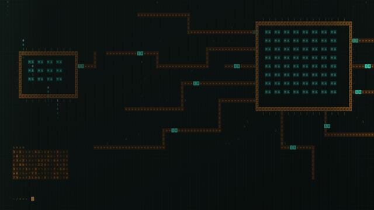</a><br><b>Silicon</b><br><sub>a die waking up</sub></td>
<td align="center"><a href="assets/previews/attention.svg">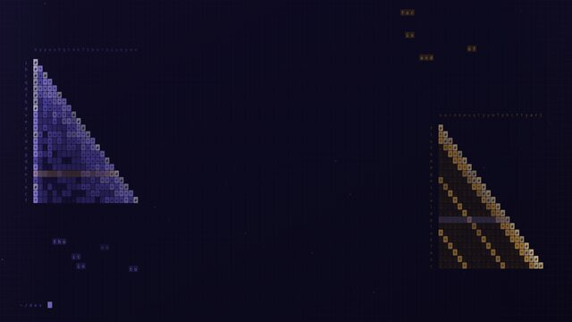</a><br><b>Attention</b><br><sub>heads reading tokens</sub></td>
<td align="center"><a href="assets/previews/gitGraph.svg">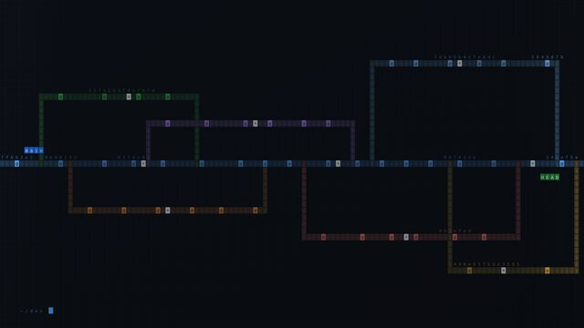</a><br><b>Commit Graph</b><br><sub>branches and merges</sub></td>
<td align="center"><a href="assets/previews/mesh.svg">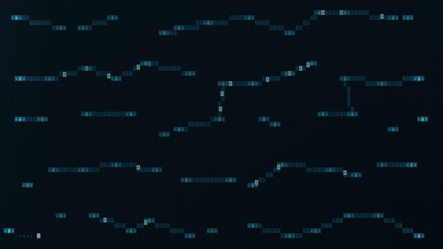</a><br><b>Network Mesh</b><br><sub>packets on a graph</sub></td>
</tr>
<tr>
<td align="center"><a href="assets/previews/serverRack.svg">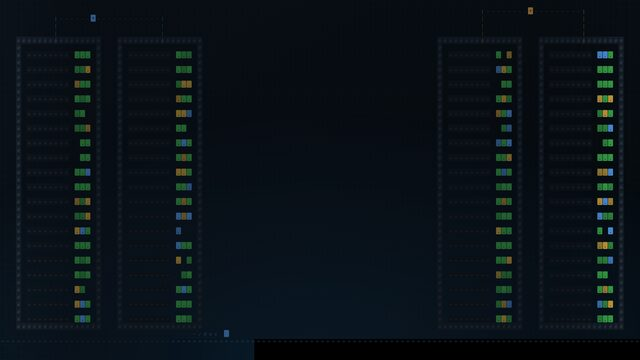</a><br><b>Server Room</b><br><sub>racks and blinking lights</sub></td>
<td align="center"><a href="assets/previews/terminal.svg">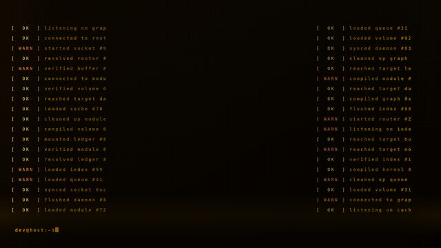</a><br><b>Terminal</b><br><sub>amber phosphor logs</sub></td>
<td align="center"><a href="assets/previews/library.svg">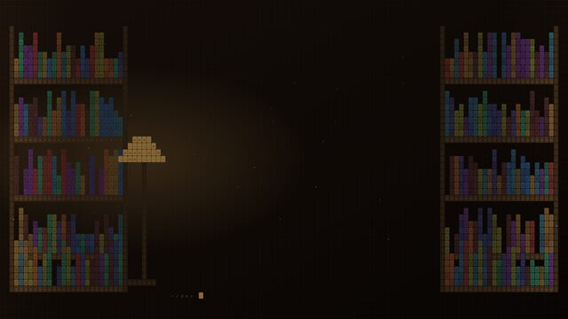</a><br><b>Library</b><br><sub>shelves, a lamp, dust</sub></td>
<td align="center"><a href="assets/previews/constellations.svg"></a><br><b>Constellations</b><br><sub>stars joined by lines</sub></td>
</tr>
<tr>
<td align="center"><a href="assets/previews/blueprint.svg">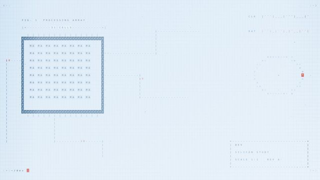</a><br><b>Blueprint</b> ☀<br><sub>daylight drafting</sub></td>
<td align="center"><a href="assets/previews/graphPaper.svg">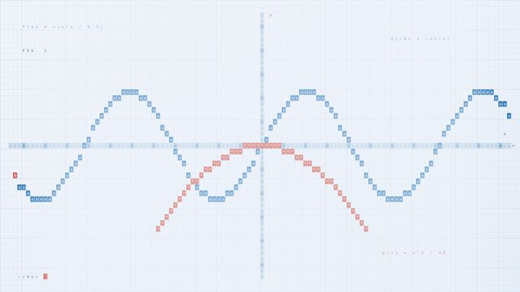</a><br><b>Graph Paper</b> ☀<br><sub>a curve being traced</sub></td>
<td align="center"><a href="assets/previews/zen.svg"></a><br><b>Zen Garden</b> ☀<br><sub>raked sand, falling petals</sub></td>
<td align="center"><a href="assets/previews/tide.svg">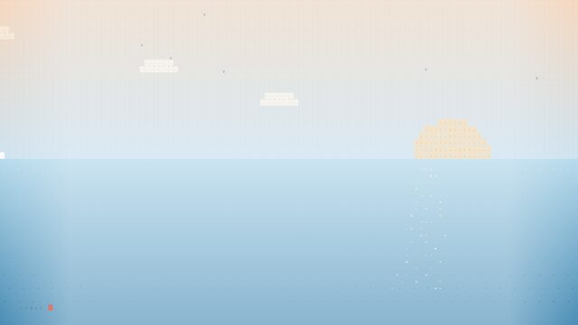</a><br><b>Tide</b> ☀<br><sub>a slow sea at dawn</sub></td>
</tr>
</table>

### Chill · 10

Cozy and slow. Warm light, weather and quiet motion.

<table>
<tr>
<td align="center"><a href="assets/previews/night.svg"></a><br><b>Night Shift</b><br><sub>moon, code, a prompt</sub></td>
<td align="center"><a href="assets/previews/rainy.svg"></a><br><b>Rainy Window</b><br><sub>coffee and rain</sub></td>
<td align="center"><a href="assets/previews/snowCabin.svg"></a><br><b>Snow Cabin</b><br><sub>a lit window in the snow</sub></td>
<td align="center"><a href="assets/previews/lighthouse.svg">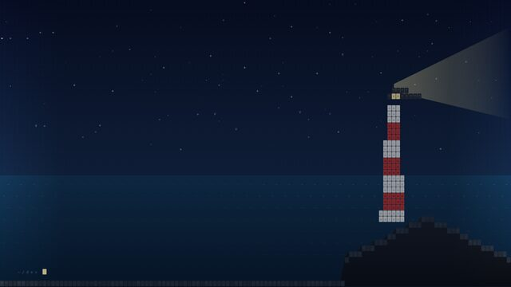</a><br><b>Lighthouse</b><br><sub>a beam over black water</sub></td>
</tr>
<tr>
<td align="center"><a href="assets/previews/campfire.svg">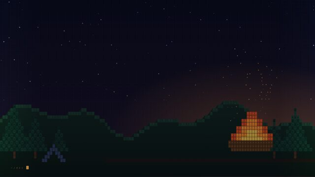</a><br><b>Campfire</b><br><sub>flames and sparks</sub></td>
<td align="center"><a href="assets/previews/lofi.svg"></a><br><b>Lo-fi Room</b><br><sub>string lights and a desk</sub></td>
<td align="center"><a href="assets/previews/lavaLamp.svg"></a><br><b>Lava Lamp</b><br><sub>slow rising blobs</sub></td>
<td align="center"><a href="assets/previews/nightTrain.svg">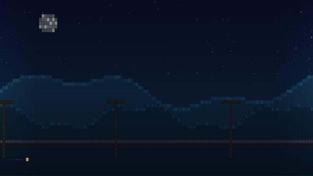</a><br><b>Night Train</b><br><sub>lit windows crossing hills</sub></td>
</tr>
<tr>
<td align="center"><a href="assets/previews/cherry.svg"></a><br><b>Cherry Blossom</b> ☀<br><sub>petals on the wind</sub></td>
<td align="center"><a href="assets/previews/autumn.svg">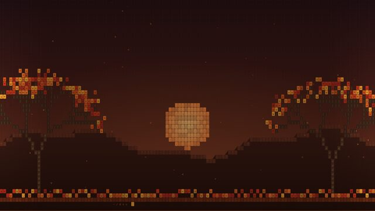</a><br><b>Autumn</b><br><sub>bare trees, falling leaves</sub></td>
<td></td>
<td></td>
</tr>
</table>

### Nature · 9

Mountains, water and weather.

<table>
<tr>
<td align="center"><a href="assets/previews/aurora.svg">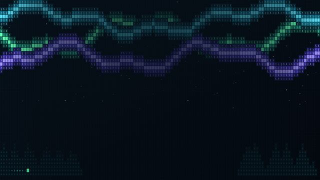</a><br><b>Aurora</b><br><sub>northern lights</sub></td>
<td align="center"><a href="assets/previews/mist.svg">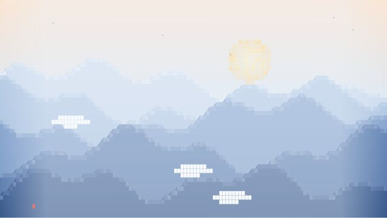</a><br><b>Misty Peaks</b> ☀<br><sub>ridges in the fog</sub></td>
<td align="center"><a href="assets/previews/dunes.svg"></a><br><b>Dunes</b> ☀<br><sub>sand, wind, a caravan</sub></td>
<td align="center"><a href="assets/previews/canyon.svg"></a><br><b>Canyon</b><br><sub>red stone and a river</sub></td>
</tr>
<tr>
<td align="center"><a href="assets/previews/oceanSunset.svg">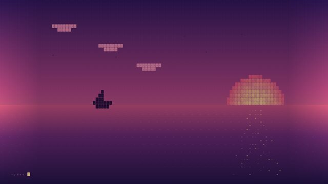</a><br><b>Ocean Sunset</b><br><sub>the sun going under</sub></td>
<td align="center"><a href="assets/previews/waterfall.svg">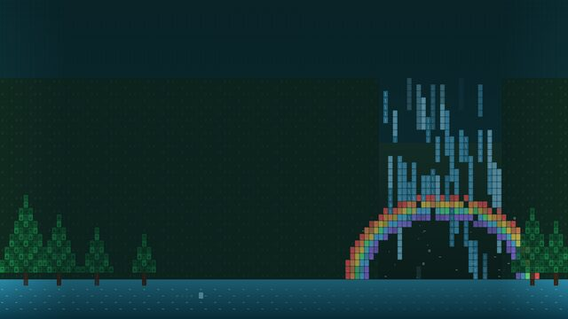</a><br><b>Waterfall</b><br><sub>spray and a rainbow</sub></td>
<td align="center"><a href="assets/previews/deepSea.svg"></a><br><b>Deep Sea</b><br><sub>light rays and an angler</sub></td>
<td align="center"><a href="assets/previews/bamboo.svg">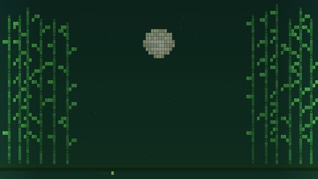</a><br><b>Bamboo Grove</b><br><sub>stalks swaying in the dark</sub></td>
</tr>
<tr>
<td align="center"><a href="assets/previews/thunder.svg"></a><br><b>Thunderstorm</b><br><sub>lightning over a city</sub></td>
<td></td>
<td></td>
<td></td>
</tr>
</table>

### Space · 7

The dark between things, and the bright things in it.

<table>
<tr>
<td align="center"><a href="assets/previews/orbit.svg"></a><br><b>Orbit</b><br><sub>a ringed planet</sub></td>
<td align="center"><a href="assets/previews/nebula.svg"></a><br><b>Nebula</b><br><sub>colored gas clouds</sub></td>
<td align="center"><a href="assets/previews/galaxy.svg"></a><br><b>Galaxy</b><br><sub>two spirals</sub></td>
<td align="center"><a href="assets/previews/blackHole.svg"></a><br><b>Black Hole</b><br><sub>a bent ring of light</sub></td>
</tr>
<tr>
<td align="center"><a href="assets/previews/rocket.svg"></a><br><b>Rocket Launch</b><br><sub>liftoff from the pad</sub></td>
<td align="center"><a href="assets/previews/meteors.svg"></a><br><b>Meteor Shower</b><br><sub>streaks over a campsite</sub></td>
<td align="center"><a href="assets/previews/warp.svg"></a><br><b>Warp</b><br><sub>stars at light speed</sub></td>
<td></td>
</tr>
</table>

### Energy · 13

Enjoy mode. Loud, bright and moving: arcade, neon and fire.

<table>
<tr>
<td align="center"><a href="assets/previews/iron.svg"></a><br><b>Iron</b><br><sub>one more rep</sub></td>
<td align="center"><a href="assets/previews/codeRain.svg">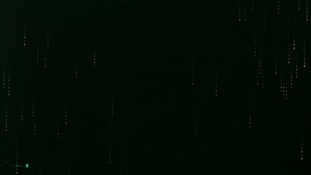</a><br><b>Code Rain</b><br><sub>green phosphor</sub></td>
<td align="center"><a href="assets/previews/outrun.svg">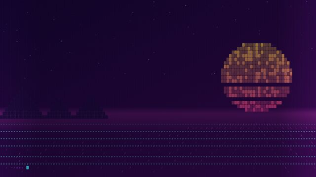</a><br><b>Outrun</b><br><sub>neon horizon</sub></td>
<td align="center"><a href="assets/previews/equalizer.svg"></a><br><b>Equalizer</b><br><sub>a VU meter dancing</sub></td>
</tr>
<tr>
<td align="center"><a href="assets/previews/neonCity.svg"></a><br><b>Neon City</b><br><sub>signs and flying cars</sub></td>
<td align="center"><a href="assets/previews/fireworks.svg">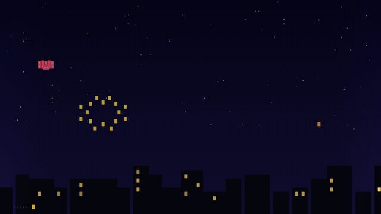</a><br><b>Fireworks</b><br><sub>bursts over a skyline</sub></td>
<td align="center"><a href="assets/previews/disco.svg">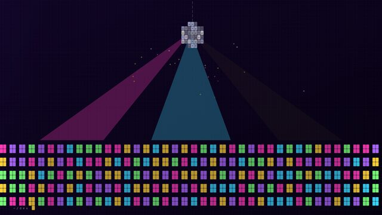</a><br><b>Disco</b><br><sub>mirror ball and a floor</sub></td>
<td align="center"><a href="assets/previews/plasma.svg">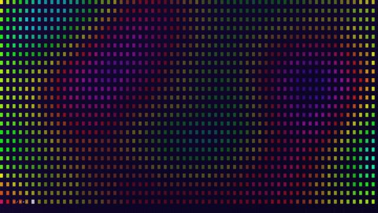</a><br><b>LED Plasma</b><br><sub>a matrix of color</sub></td>
</tr>
<tr>
<td align="center"><a href="assets/previews/invaders.svg">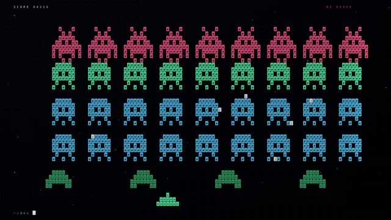</a><br><b>Invaders</b><br><sub>the fleet marches</sub></td>
<td align="center"><a href="assets/previews/pong.svg"></a><br><b>Pong</b><br><sub>ball, paddles, a rally</sub></td>
<td align="center"><a href="assets/previews/snake.svg"></a><br><b>Snake</b><br><sub>a long snake and apples</sub></td>
<td align="center"><a href="assets/previews/tetris.svg"></a><br><b>Tetris Rain</b><br><sub>pieces falling in two wells</sub></td>
</tr>
<tr>
<td align="center"><a href="assets/previews/volcano.svg"></a><br><b>Volcano</b><br><sub>lava bombs and embers</sub></td>
<td></td>
<td></td>
<td></td>
</tr>
</table>

### Dev · 10

Hardcore coder mode. Dark, moody and minimal: editors, memory, assembly, diffs, green test runs and the quiet between commands. One accent per scene, nothing that shouts.

<table>
<tr>
<td align="center"><a href="assets/previews/vim.svg">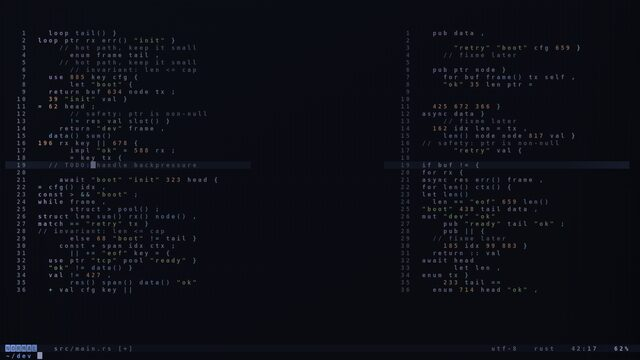</a><br><b>Vim Night</b><br><sub>a modal editor at 2am</sub></td>
<td align="center"><a href="assets/previews/hexdump.svg">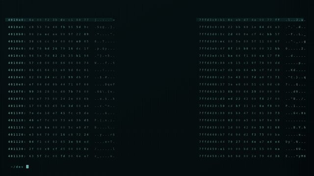</a><br><b>Hex Dump</b><br><sub>bytes and a scanning band</sub></td>
<td align="center"><a href="assets/previews/asm.svg"></a><br><b>Assembly</b><br><sub>an instruction pointer walks</sub></td>
<td align="center"><a href="assets/previews/sorting.svg">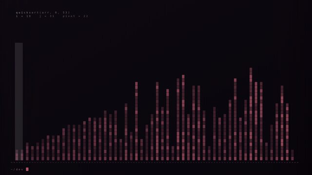</a><br><b>Sorting</b><br><sub>bars and a comparing cursor</sub></td>
</tr>
<tr>
<td align="center"><a href="assets/previews/bigO.svg"></a><br><b>Big O</b><br><sub>six growth curves</sub></td>
<td align="center"><a href="assets/previews/diff.svg"></a><br><b>Diff</b><br><sub>hunks, adds and removes</sub></td>
<td align="center"><a href="assets/previews/tests.svg"></a><br><b>Green CI</b><br><sub>a test matrix going green</sub></td>
<td align="center"><a href="assets/previews/voidCursor.svg"></a><br><b>The Void</b><br><sub>a prompt and a cursor</sub></td>
</tr>
<tr>
<td align="center"><a href="assets/previews/compiler.svg"></a><br><b>Compiler</b><br><sub>a syntax tree being walked</sub></td>
<td align="center"><a href="assets/previews/panic.svg">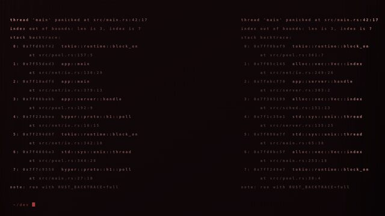</a><br><b>Kernel Panic</b><br><sub>a stack trace in red</sub></td>
</tr>
</table>

## Install

You need **Claude Code 2.1.325 or later** (`claude --version`, `claude update`). The wallpapers draw in the **Code tab of Claude Desktop**; a plain terminal keeps its own look.

At the prompt of a Claude Code terminal session:

```text
/plugin install ascii-wallpaper-collection --marketplace deaneeth/claude-code-ascii-wallpapers
```

Answer `y` to add the marketplace, pick a scope (user scope puts it in every session), and enter your handle when asked.

From a shell:

```bash
claude plugin install ascii-wallpaper-collection --marketplace deaneeth/claude-code-ascii-wallpapers
```

In the Claude Desktop app, where `/plugin` does not run: click **+** next to the prompt box, then **Plugins**, **Add marketplace** with `deaneeth/claude-code-ascii-wallpapers`, then **Add plugin**.

Then start a new session in the Code tab.

## Use

| Do this | To get |
| --- | --- |
| `/wallpaper` | The picker above the prompt: pick a mode, then a scene. Click, or press `1` to `9` for a scene, `f` `c` `n` `s` `e` for a mode, `0` for off. |
| `/wallpaper aurora` | A scene by name (try `/wallpaper list` for every key). |
| `/wallpaper work` | A random **Focus** scene. Also `chill`, `nature`, `space`, `dev` (hardcore coder), and `enjoy` (Energy). |
| `/wallpaper next` | The next scene in the current mode. |
| `/wallpaper random` | A surprise from all 61. |
| `/wallpaper off` | No wallpaper, the app's own look. |

Your pick is remembered for the next session. The first run starts on **Silicon**.

## Make it yours

The scenes sign **your handle** in a corner (`~/yourhandle` with a blinking cursor), in the Blueprint title block, in the Night Shift and Terminal prompts, and on the Graph Paper sheet. Set it when you install, or change it later in Claude Code's `/config` menu under this plugin's **Your handle** row. Letters, digits, `.`, `_` and `-` only, up to 16.

Prefer settings files? Add this to `~/.claude/settings.json`:

```json
{
  "pluginConfigs": {
    "ascii-wallpaper-collection": { "options": { "name": "yourhandle" } }
  }
}
```

## How it works

- **Scenes are plain SVG.** Each wallpaper is one SVG made of tiles (a colored plate and one glyph) placed on a 16 by 22 grid, with painted gradients for skies and water. Tiles are defined once and reused, which keeps every scene under the 131,072-character limit for a backdrop.
- **Motion is CSS.** Tiles shimmer in three phases, and things step cell to cell with stepped keyframes so movement snaps to the grid like a terminal. It all runs in a script-less sandboxed SVG frame: no JavaScript, no network.
- **The theme matches the scene.** `$.theme.set` paints about a hundred color tokens per scene from one hue and one accent, in dark or light, with code highlighting. Panels become frosted glass (blur 18, 50% tint) over the wallpaper.
- **Reduced motion is respected.** With "reduce motion" on in your system, the scenes hold still.
- **Text stays readable.** Each theme is run through Claude Code's color checker with high-contrast text on every surface, and none trips its "won't paint" failure. Permission prompts always keep the app's own look.

## FAQ

**Which Claude apps does it work in?** The Code tab of Claude Desktop. The terminal and editor extensions keep their own look.

**Nothing changes after I install it.** Start a new session after installing, and make sure Claude Code is 2.1.325 or later. If you run another plugin that sets a theme, turn it off: only one theme can be active at a time.

**Which scenes are light?** Blueprint, Graph Paper, Zen Garden, Tide, Cherry Blossom, Misty Peaks, Dunes. The rest are dark.

**Can I use my own colors with a scene?** Scene colors come from the `WALLS` table in [`hooks/register.tsx`](hooks/register.tsx): a hue and an accent per scene. Edit a row, bump `BUILD`, and reload.

**How do I remove it?** `claude plugin uninstall ascii-wallpaper-collection`.

**Does it slow Claude down?** The scenes are small static documents animated by the renderer, not scripts. The heaviest are around 110 KB of SVG. If your machine struggles, pick a quieter scene (Blueprint, Zen Garden, Constellations, Misty Peaks) or `/wallpaper off`.

## Contributing

New scenes are welcome. Each one is a function built from a small set of drawing helpers in [`hooks/engine.js`](hooks/engine.js). See [CONTRIBUTING.md](CONTRIBUTING.md) for how to add one, preview it, and register it in the picker.

## License

[MIT](LICENSE) © deaneeth. Not affiliated with or endorsed by Anthropic; "Claude" is a trademark of its owner.
