<div align="center">

# Claude Code ASCII Wallpapers

**Eleven live, animated ASCII wallpapers and themes for Claude Desktop, with frosted-glass panels, a one-key picker, and your own handle signed into every scene.**

[](LICENSE)
[](https://docs.claude.com/en/docs/claude-code)
[](#the-collection)
[](#the-collection)

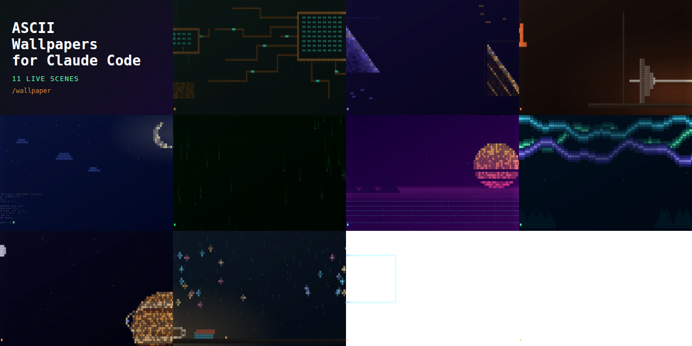

</div>

Give the Code tab of **Claude Desktop** a living background. Every wallpaper is a scene built from shimmering character tiles that drift, pulse and scroll: chips waking up, a barbell doing reps, rain on a window, northern lights, a neon horizon. The window's panels turn to frosted glass over it, so the chat stays easy to read. Each scene ships with its own matching color theme (surfaces, text, accent, code highlighting) in dark or light.

It installs as a **Claude Code plugin**, so there is nothing to build: one command, then `/wallpaper`.

## The collection

Click a preview to open the animated SVG.

<table>
<tr>
<td align="center"><a href="assets/previews/silicon.svg"></a><br><b>Silicon</b> · dark<br><sub>a die waking up</sub></td>
<td align="center"><a href="assets/previews/attention.svg"></a><br><b>Attention</b> · dark<br><sub>heads reading tokens</sub></td>
<td align="center"><a href="assets/previews/iron.svg"></a><br><b>Iron</b> · dark<br><sub>one more rep</sub></td>
</tr>
<tr>
<td align="center"><a href="assets/previews/night.svg"></a><br><b>Night Shift</b> · dark<br><sub>moon, code, a prompt</sub></td>
<td align="center"><a href="assets/previews/codeRain.svg"></a><br><b>Code Rain</b> · dark<br><sub>green phosphor</sub></td>
<td align="center"><a href="assets/previews/outrun.svg"></a><br><b>Outrun</b> · dark<br><sub>neon horizon</sub></td>
</tr>
<tr>
<td align="center"><a href="assets/previews/aurora.svg"></a><br><b>Aurora</b> · dark<br><sub>northern lights</sub></td>
<td align="center"><a href="assets/previews/orbit.svg"></a><br><b>Orbit</b> · dark<br><sub>a ringed planet</sub></td>
<td align="center"><a href="assets/previews/rainy.svg"></a><br><b>Rainy Window</b> · dark<br><sub>coffee and rain</sub></td>
</tr>
<tr>
<td align="center"><a href="assets/previews/blueprint.svg"></a><br><b>Blueprint</b> · light<br><sub>daylight drafting</sub></td>
<td align="center"><a href="assets/previews/zen.svg"></a><br><b>Zen Garden</b> · light<br><sub>raked sand, falling petals</sub></td>
<td></td>
</tr>
</table>

| Scene | Mode | What moves |
| --- | --- | --- |
| **Silicon** | dark | Processing elements light in a diagonal wave, bits stream down the edge and along copper traces, an SRAM bank twinkles. |
| **Attention** | dark | A causal and a banded attention matrix, a query row sweeping down each, tokens drifting past. |
| **Iron** | dark | A loaded barbell does a rep every seven seconds under an ember glow, chalk rises, a big counter ticks 1 to 8. |
| **Night Shift** | dark | A tile-built crescent moon, twinkling stars, sliding clouds, scrolling code, a blinking prompt, a shooting star. |
| **Code Rain** | dark | Columns of green code fall at different speeds. |
| **Outrun** | dark | A sliced sun, mountains, and rows of neon grid rolling toward you. |
| **Aurora** | dark | Ribbons of light with a brightness wave that travels along them, over a pine ridge. |
| **Orbit** | dark | A banded planet with a ring, two satellites circling, a small moon drifting across. |
| **Rainy Window** | dark | Rain streaks and slow drops over blurred city lights, steam rising from a mug. |
| **Blueprint** | light | A chip as a drafting sheet: bits move along traces, clock and data lines scroll, a dot orbits a ring. |
| **Zen Garden** | light | Raked sand ripples around mossy stones while petals drift down. |

## Install

You need **Claude Code 2.1.325 or later** (`claude --version`, `claude update`). The wallpapers draw in the **Code tab of Claude Desktop**; a plain terminal keeps its own look.

At the prompt of a Claude Code terminal session:

```text
/plugin install ascii-wallpaper-collection --marketplace deaneeth/claude-code-ascii-wallpapers
```

Answer `y` to add the marketplace, pick a scope (user scope puts it in every session), and enter your handle when asked.

From a shell:

```bash
claude plugin install ascii-wallpaper-collection --marketplace deaneeth/claude-code-ascii-wallpapers
```

In the Claude Desktop app, where `/plugin` does not run: click **+** next to the prompt box, then **Plugins**, **Add marketplace** with `deaneeth/claude-code-ascii-wallpapers`, then **Add plugin**.

Then start a new session in the Code tab.

## Use

| Do this | To get |
| --- | --- |
| `/wallpaper` | The picker above the prompt. Click a scene, or press `1` to `9`; `0` turns it off. |
| `/wallpaper aurora` | A scene by name (`silicon`, `attention`, `iron`, `night`, `codeRain`, `outrun`, `aurora`, `orbit`, `rainy`, `blueprint`, `zen`). |
| `/wallpaper next` | The next scene in the list. |
| `/wallpaper random` | A surprise. |
| `/wallpaper off` | No wallpaper, the app's own look. |

Your pick is remembered for the next session. The first run starts on **Silicon**.

## Make it yours

The scenes sign **your handle** in a corner (`~/yourhandle` with a blinking cursor), in the Blueprint title block, and in the Night Shift prompt. Set it when you install, or change it later in Claude Code's `/config` menu under this plugin's **Your handle** row. Letters, digits, `.`, `_` and `-` only, up to 16.

Prefer settings files? Add this to `~/.claude/settings.json`:

```json
{
  "pluginConfigs": {
    "ascii-wallpaper-collection": { "options": { "name": "yourhandle" } }
  }
}
```

## How it works

- **Scenes are plain SVG.** Each wallpaper is one SVG made of tiles (a colored plate and one glyph) placed on a 16 by 22 grid. Tiles are defined once and reused, which keeps every scene under the 131,072-character limit for a backdrop.
- **Motion is CSS.** Tiles shimmer in three phases, and things step cell to cell with stepped keyframes so movement snaps to the grid like a terminal. It all runs in a script-less sandboxed SVG frame: no JavaScript, no network.
- **The theme matches the scene.** `$.theme.set` paints about a hundred color tokens per scene from a handful of seeds, in dark or light, with code highlighting. Panels become frosted glass (blur 18, 50% tint) over the wallpaper.
- **Reduced motion is respected.** With "reduce motion" on in your system, the scenes hold still.
- **Text stays readable.** Each theme is run through Claude Code's color checker with high-contrast text on every surface, and none trips its "won't paint" failure. Permission prompts always keep the app's own look.

## FAQ

**Which Claude apps does it work in?** The Code tab of Claude Desktop. The terminal and editor extensions keep their own look.

**Nothing changes after I install it.** Start a new session after installing, and make sure Claude Code is 2.1.325 or later. If you run another plugin that sets a theme, turn it off: only one theme can be active at a time.

**Can I use my own colors with a scene?** Scene colors live in the `WALLS` table in [`hooks/register.tsx`](hooks/register.tsx). Edit a row, bump `BUILD`, and reload.

**How do I remove it?** `claude plugin uninstall ascii-wallpaper-collection`.

**Does it slow Claude down?** The scenes are small static documents animated by the renderer, not scripts. The heaviest scenes are around 110 KB of SVG. If your machine struggles, pick a quieter scene (Blueprint, Zen Garden, Orbit) or `/wallpaper off`.

## Contributing

New scenes are welcome. Each one is a function in [`hooks/art.js`](hooks/art.js) built from a handful of helpers (`tile`, `put`, `sprite`, `mover`, `phased`, `die`). See [CONTRIBUTING.md](CONTRIBUTING.md) for how to add one, preview it, and register it in the picker.

## License

[MIT](LICENSE) © deaneeth. Not affiliated with or endorsed by Anthropic; "Claude" is a trademark of its owner.
