<div align="center">

# Claude Code ASCII Wallpapers

**93 live, animated ASCII wallpapers and themes for Claude Desktop, in nine modes, with frosted-glass panels, a thumbnail picker, scenes that react to your commands, and your own handle signed into every scene.**

[](LICENSE)
[](https://docs.claude.com/en/docs/claude-code)
[](#the-collection)
[](#the-collection)


</div>

Give the Code tab of **Claude Desktop** a living background. Every wallpaper is a scene built from shimmering character tiles that drift, pulse and scroll: a chip waking up, a barbell doing reps, rain on a window, northern lights, a neon skyline, a rocket on the pad, a fleet of invaders marching. The window's panels turn to frosted glass over it, so the chat stays easy to read. Each scene ships with its own matching color theme (surfaces, text, accent, code highlighting), in dark or light.

It installs as a **Claude Code plugin**, so there is nothing to build: one command, then `/wallpaper`.

## The collection

<!-- gallery:start -->
**93 scenes in 9 modes.** Pick a mode for the mood you are in, then a scene. Click any preview to open the animated SVG (17 light-mode scenes are marked ☀).

| Mode | Scenes | For |
| --- | --- | --- |
| **Focus** | 14 | Work mode: calm, readable, low-distraction. |
| **Chill** | 13 | Cozy and slow. |
| **Nature** | 16 | Weather, water and mountains. |
| **Space** | 7 | The dark between things. |
| **Energy** | 13 | Enjoy mode: loud, bright, moving. |
| **Dev** | 10 | Hardcore coder: dark, moody, minimal. |
| **Creatures** | 10 | Things that live in the picture. |
| **Art** | 6 | Graphic styles: halftone, dither, riso. |
| **Minimal** | 4 | Almost nothing behind the chat. |

### Focus · 14

Work mode. Calm, readable and low-distraction, for long stretches of deep work.

<table>
<tr>
<td align="center"><a href="assets/previews/silicon.svg"></a><br><b>Silicon</b><br><sub>a die waking up</sub></td>
<td align="center"><a href="assets/previews/attention.svg"></a><br><b>Attention</b><br><sub>heads reading tokens</sub></td>
<td align="center"><a href="assets/previews/gitGraph.svg"></a><br><b>Commit Graph</b><br><sub>branches and merges</sub></td>
<td align="center"><a href="assets/previews/mesh.svg"></a><br><b>Network Mesh</b><br><sub>packets on a graph</sub></td>
</tr>
<tr>
<td align="center"><a href="assets/previews/serverRack.svg"></a><br><b>Server Room</b><br><sub>racks and blinking lights</sub></td>
<td align="center"><a href="assets/previews/terminal.svg"></a><br><b>Terminal</b><br><sub>amber phosphor logs</sub></td>
<td align="center"><a href="assets/previews/library.svg"></a><br><b>Library</b><br><sub>shelves, a lamp, dust</sub></td>
<td align="center"><a href="assets/previews/constellations.svg">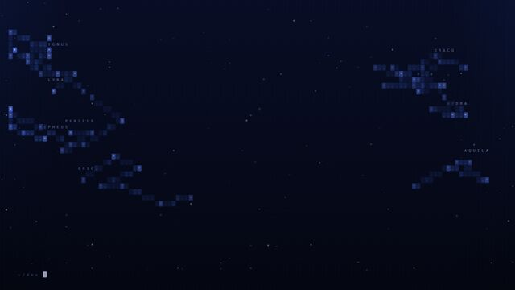</a><br><b>Constellations</b><br><sub>stars joined by lines</sub></td>
</tr>
<tr>
<td align="center"><a href="assets/previews/blueprint.svg"></a><br><b>Blueprint</b> ☀<br><sub>daylight drafting</sub></td>
<td align="center"><a href="assets/previews/graphPaper.svg"></a><br><b>Graph Paper</b> ☀<br><sub>a curve being traced</sub></td>
<td align="center"><a href="assets/previews/zen.svg">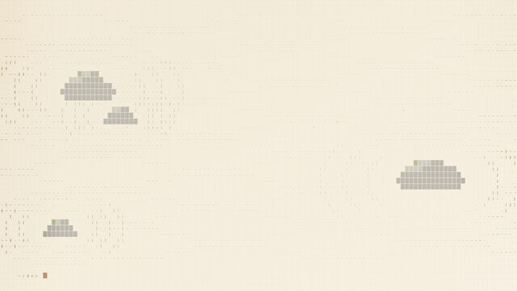</a><br><b>Zen Garden</b> ☀<br><sub>raked sand, falling petals</sub></td>
<td align="center"><a href="assets/previews/tide.svg"></a><br><b>Tide</b> ☀<br><sub>a slow sea at dawn</sub></td>
</tr>
<tr>
<td align="center"><a href="assets/previews/greenhouse.svg">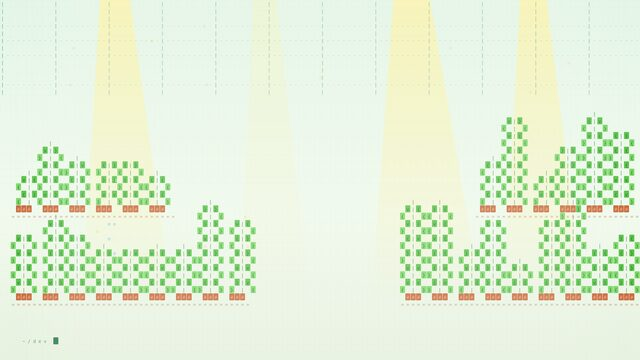</a><br><b>Greenhouse</b> ☀<br><sub>plants in sunbeams</sub></td>
<td align="center"><a href="assets/previews/sketch.svg">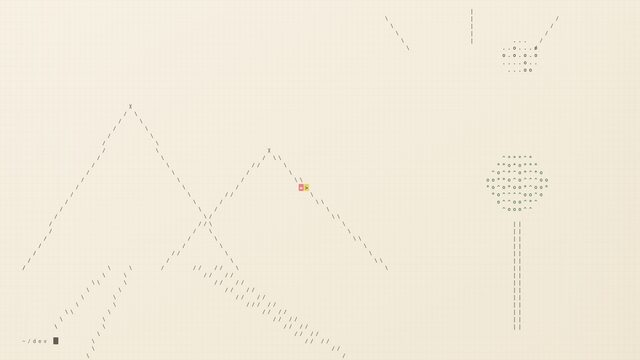</a><br><b>Sketchbook</b> ☀<br><sub>a drawing being made</sub></td>
</tr>
</table>

### Chill · 13

Cozy and slow. Warm light, weather and quiet motion.

<table>
<tr>
<td align="center"><a href="assets/previews/night.svg">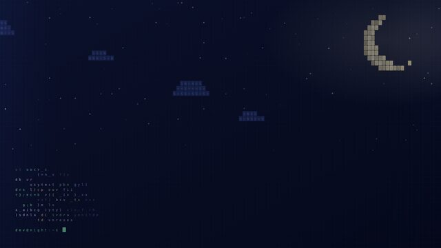</a><br><b>Night Shift</b><br><sub>moon, code, a prompt</sub></td>
<td align="center"><a href="assets/previews/rainy.svg">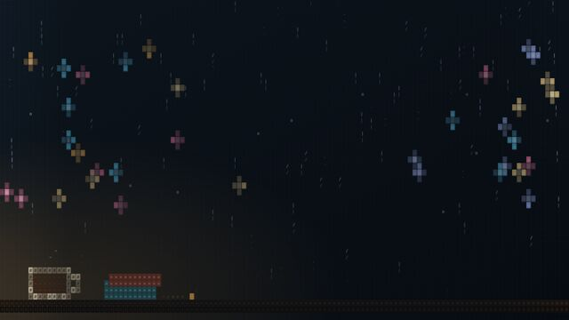</a><br><b>Rainy Window</b><br><sub>coffee and rain</sub></td>
<td align="center"><a href="assets/previews/snowCabin.svg">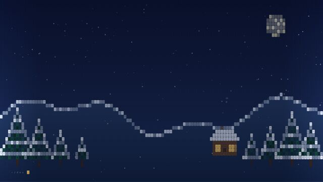</a><br><b>Snow Cabin</b><br><sub>a lit window in the snow</sub></td>
<td align="center"><a href="assets/previews/lighthouse.svg"></a><br><b>Lighthouse</b><br><sub>a beam over black water</sub></td>
</tr>
<tr>
<td align="center"><a href="assets/previews/campfire.svg"></a><br><b>Campfire</b><br><sub>flames and sparks</sub></td>
<td align="center"><a href="assets/previews/lofi.svg">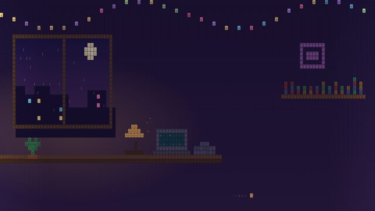</a><br><b>Lo-fi Room</b><br><sub>string lights and a desk</sub></td>
<td align="center"><a href="assets/previews/lavaLamp.svg">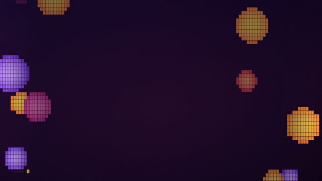</a><br><b>Lava Lamp</b><br><sub>slow rising blobs</sub></td>
<td align="center"><a href="assets/previews/nightTrain.svg"></a><br><b>Night Train</b><br><sub>lit windows crossing hills</sub></td>
</tr>
<tr>
<td align="center"><a href="assets/previews/cherry.svg">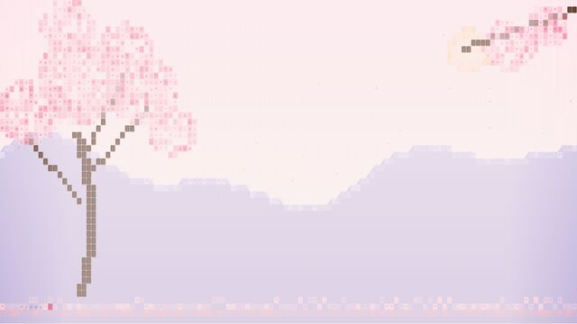</a><br><b>Cherry Blossom</b> ☀<br><sub>petals on the wind</sub></td>
<td align="center"><a href="assets/previews/autumn.svg"></a><br><b>Autumn</b><br><sub>bare trees, falling leaves</sub></td>
<td align="center"><a href="assets/previews/snowDay.svg">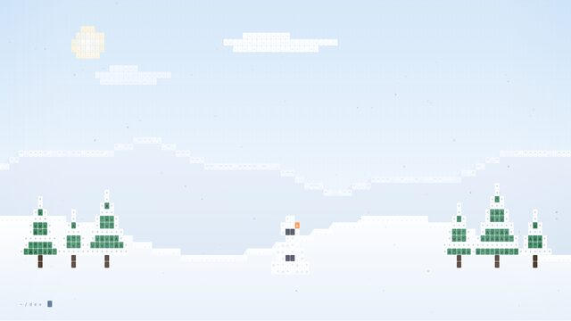</a><br><b>Snow Day</b> ☀<br><sub>a snowman and a sled</sub></td>
<td align="center"><a href="assets/previews/pastelCity.svg">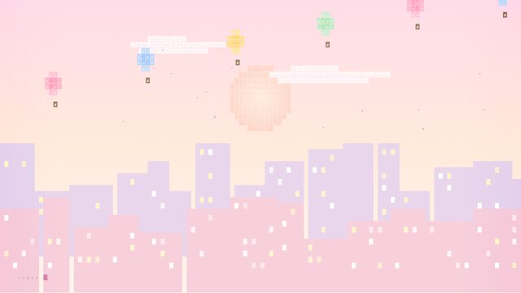</a><br><b>Pastel City</b> ☀<br><sub>balloons over soft towers</sub></td>
</tr>
<tr>
<td align="center"><a href="assets/previews/kite.svg">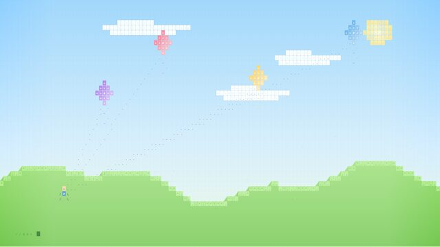</a><br><b>Kite Day</b> ☀<br><sub>four kites on strings</sub></td>
</tr>
</table>

### Nature · 16

Mountains, water, weather and the seasons.

<table>
<tr>
<td align="center"><a href="assets/previews/aurora.svg"></a><br><b>Aurora</b><br><sub>northern lights</sub></td>
<td align="center"><a href="assets/previews/mist.svg"></a><br><b>Misty Peaks</b> ☀<br><sub>ridges in the fog</sub></td>
<td align="center"><a href="assets/previews/dunes.svg">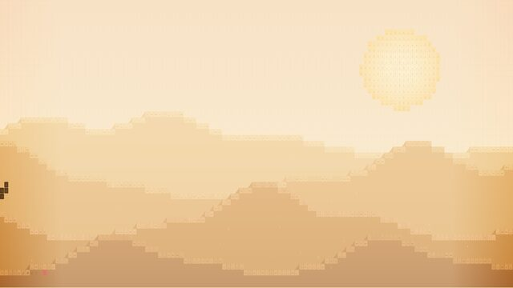</a><br><b>Dunes</b> ☀<br><sub>sand, wind, a caravan</sub></td>
<td align="center"><a href="assets/previews/canyon.svg">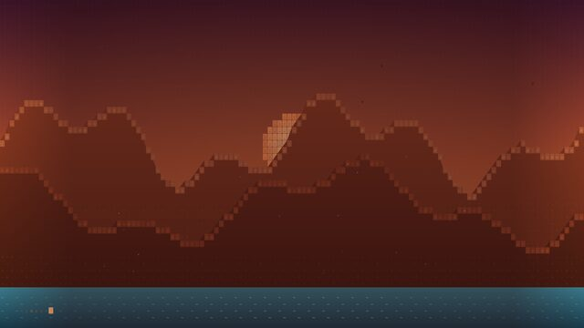</a><br><b>Canyon</b><br><sub>red stone and a river</sub></td>
</tr>
<tr>
<td align="center"><a href="assets/previews/oceanSunset.svg"></a><br><b>Ocean Sunset</b><br><sub>the sun going under</sub></td>
<td align="center"><a href="assets/previews/waterfall.svg"></a><br><b>Waterfall</b><br><sub>spray and a rainbow</sub></td>
<td align="center"><a href="assets/previews/deepSea.svg">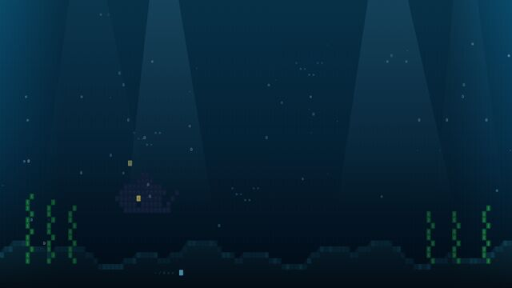</a><br><b>Deep Sea</b><br><sub>light rays and an angler</sub></td>
<td align="center"><a href="assets/previews/bamboo.svg"></a><br><b>Bamboo Grove</b><br><sub>stalks swaying in the dark</sub></td>
</tr>
<tr>
<td align="center"><a href="assets/previews/thunder.svg">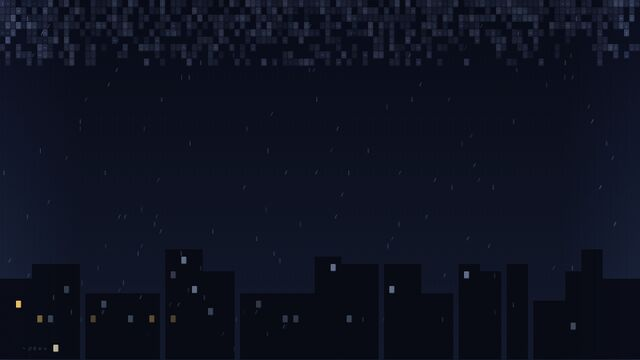</a><br><b>Thunderstorm</b><br><sub>lightning over a city</sub></td>
<td align="center"><a href="assets/previews/meadow.svg">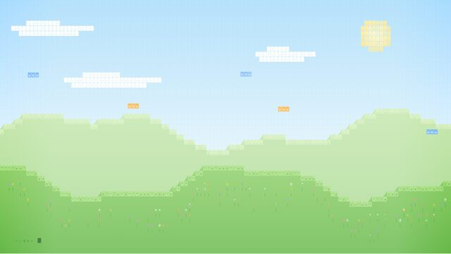</a><br><b>Spring Meadow</b> ☀<br><sub>flowers, butterflies, clouds</sub></td>
<td align="center"><a href="assets/previews/beach.svg">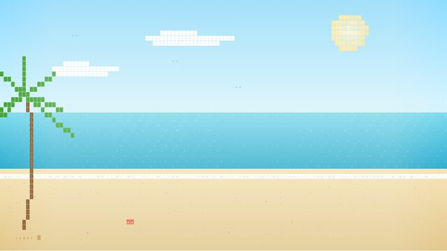</a><br><b>Low Tide</b> ☀<br><sub>foam, gulls and a palm</sub></td>
<td align="center"><a href="assets/previews/lavender.svg">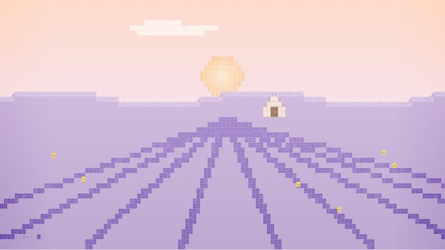</a><br><b>Lavender Rows</b> ☀<br><sub>rows to the horizon, bees</sub></td>
</tr>
<tr>
<td align="center"><a href="assets/previews/wheat.svg">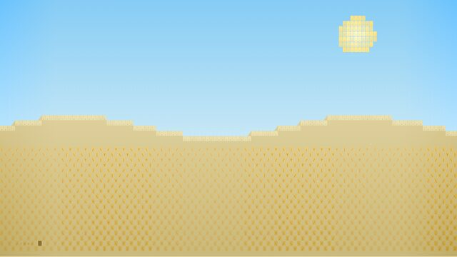</a><br><b>Summer Wheat</b> ☀<br><sub>wind crossing a field</sub></td>
<td align="center"><a href="assets/previews/springRain.svg">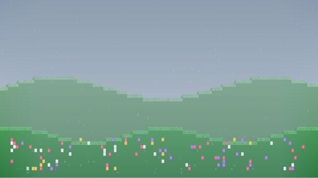</a><br><b>Spring Rain</b><br><sub>tulips in the rain</sub></td>
<td align="center"><a href="assets/previews/harvestMoon.svg">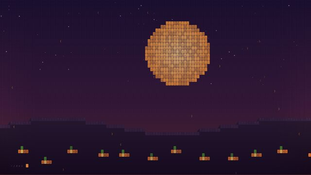</a><br><b>Harvest Moon</b><br><sub>pumpkins under a huge moon</sub></td>
<td align="center"><a href="assets/previews/iceLake.svg">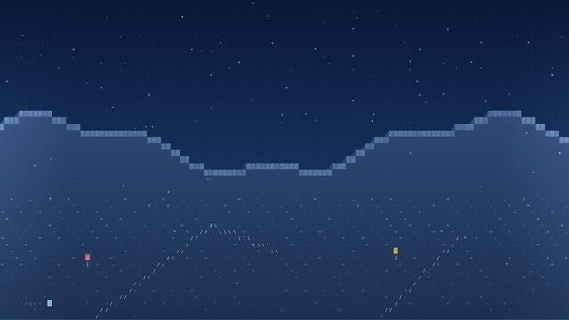</a><br><b>Ice Lake</b><br><sub>skaters on a frozen lake</sub></td>
</tr>
</table>

### Space · 7

Planets, nebulae, rockets and the dark between them.

<table>
<tr>
<td align="center"><a href="assets/previews/orbit.svg">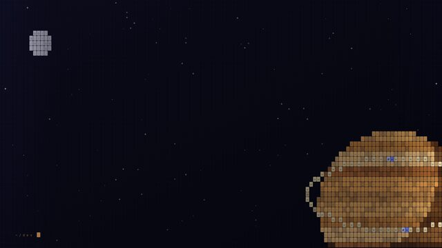</a><br><b>Orbit</b><br><sub>a ringed planet</sub></td>
<td align="center"><a href="assets/previews/nebula.svg">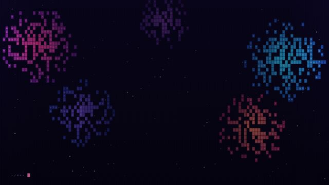</a><br><b>Nebula</b><br><sub>colored gas clouds</sub></td>
<td align="center"><a href="assets/previews/galaxy.svg">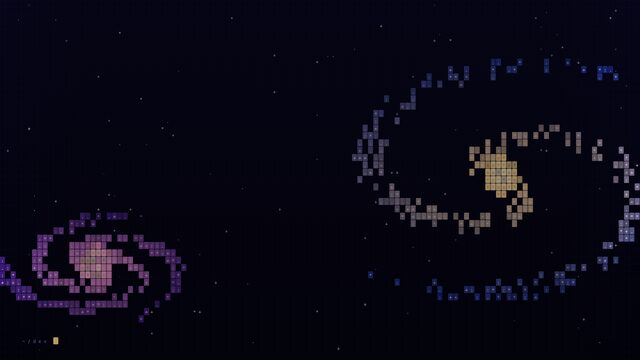</a><br><b>Galaxy</b><br><sub>two spirals</sub></td>
<td align="center"><a href="assets/previews/blackHole.svg">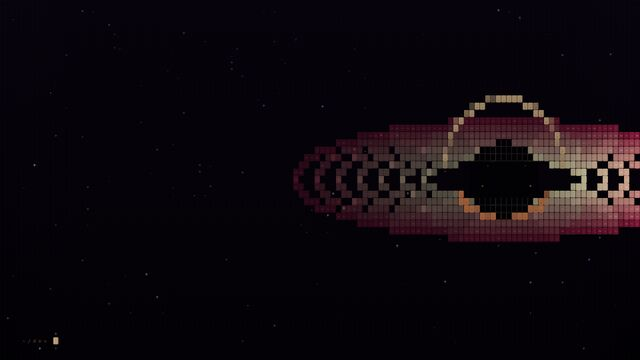</a><br><b>Black Hole</b><br><sub>a bent ring of light</sub></td>
</tr>
<tr>
<td align="center"><a href="assets/previews/rocket.svg">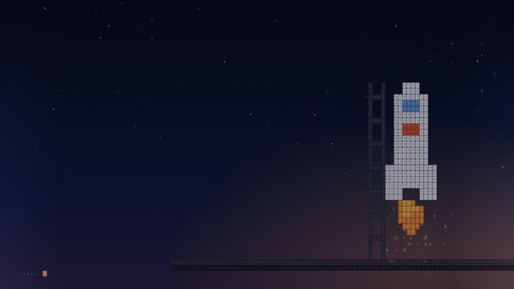</a><br><b>Rocket Launch</b><br><sub>liftoff from the pad</sub></td>
<td align="center"><a href="assets/previews/meteors.svg">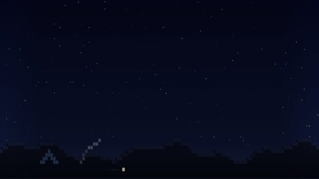</a><br><b>Meteor Shower</b><br><sub>streaks over a campsite</sub></td>
<td align="center"><a href="assets/previews/warp.svg">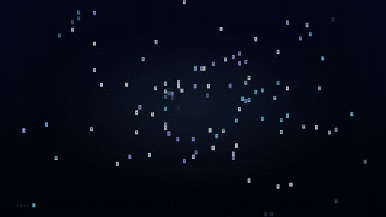</a><br><b>Warp</b><br><sub>stars at light speed</sub></td>
</tr>
</table>

### Energy · 13

Enjoy mode. Loud, bright and moving: arcade, neon and fire.

<table>
<tr>
<td align="center"><a href="assets/previews/iron.svg">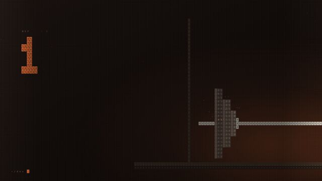</a><br><b>Iron</b><br><sub>one more rep</sub></td>
<td align="center"><a href="assets/previews/codeRain.svg"></a><br><b>Code Rain</b><br><sub>green phosphor</sub></td>
<td align="center"><a href="assets/previews/outrun.svg"></a><br><b>Outrun</b><br><sub>neon horizon</sub></td>
<td align="center"><a href="assets/previews/equalizer.svg">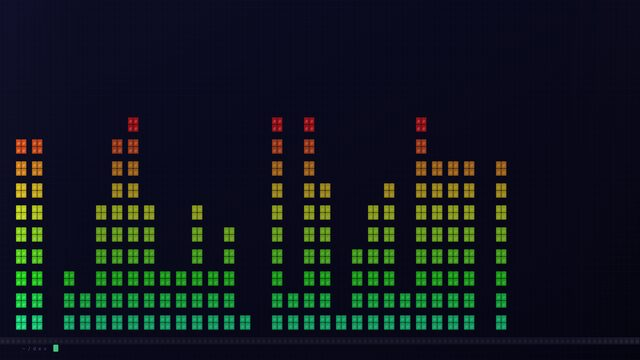</a><br><b>Equalizer</b><br><sub>a VU meter dancing</sub></td>
</tr>
<tr>
<td align="center"><a href="assets/previews/neonCity.svg">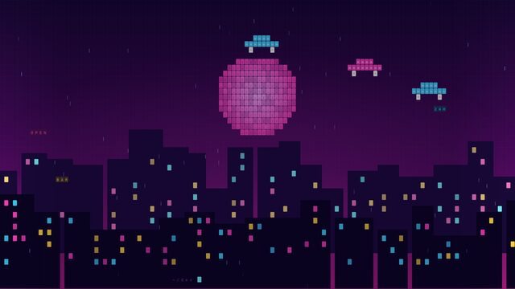</a><br><b>Neon City</b><br><sub>signs and flying cars</sub></td>
<td align="center"><a href="assets/previews/fireworks.svg"></a><br><b>Fireworks</b><br><sub>bursts over a skyline</sub></td>
<td align="center"><a href="assets/previews/disco.svg"></a><br><b>Disco</b><br><sub>mirror ball and a floor</sub></td>
<td align="center"><a href="assets/previews/plasma.svg"></a><br><b>LED Plasma</b><br><sub>a matrix of color</sub></td>
</tr>
<tr>
<td align="center"><a href="assets/previews/invaders.svg"></a><br><b>Invaders</b><br><sub>the fleet marches</sub></td>
<td align="center"><a href="assets/previews/pong.svg">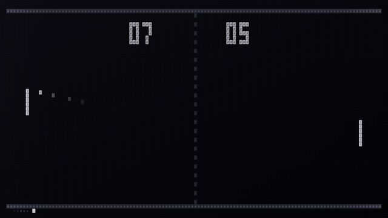</a><br><b>Pong</b><br><sub>ball, paddles, a rally</sub></td>
<td align="center"><a href="assets/previews/snake.svg">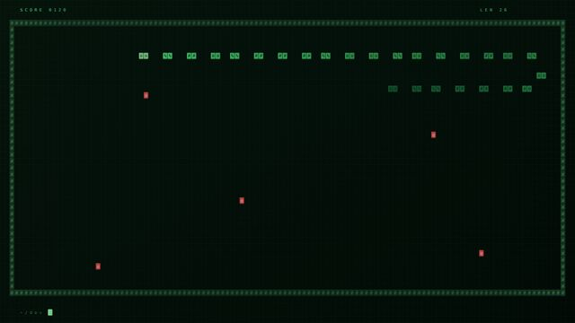</a><br><b>Snake</b><br><sub>a long snake and apples</sub></td>
<td align="center"><a href="assets/previews/tetris.svg">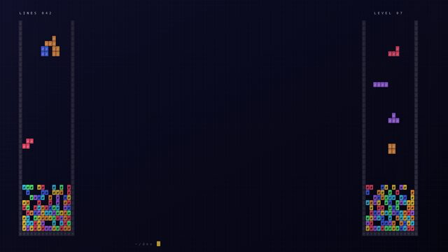</a><br><b>Tetris Rain</b><br><sub>pieces falling in two wells</sub></td>
</tr>
<tr>
<td align="center"><a href="assets/previews/volcano.svg">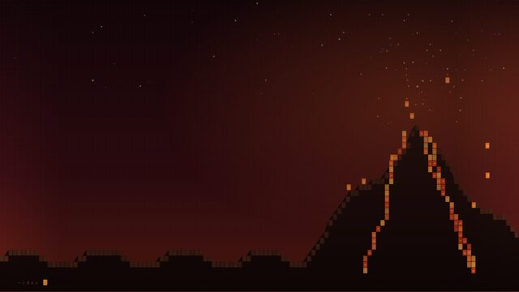</a><br><b>Volcano</b><br><sub>lava bombs and embers</sub></td>
</tr>
</table>

### Dev · 10

Hardcore coder mode. Dark, moody and minimal: editors, memory, assembly, diffs, green test runs and the quiet between commands.

<table>
<tr>
<td align="center"><a href="assets/previews/vim.svg"></a><br><b>Vim Night</b><br><sub>a modal editor at 2am</sub></td>
<td align="center"><a href="assets/previews/hexdump.svg"></a><br><b>Hex Dump</b><br><sub>bytes and a scanning band</sub></td>
<td align="center"><a href="assets/previews/asm.svg">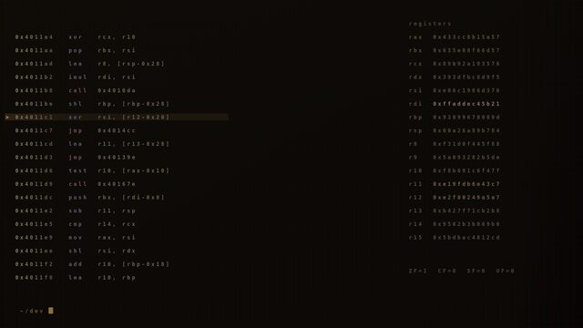</a><br><b>Assembly</b><br><sub>an instruction pointer walks</sub></td>
<td align="center"><a href="assets/previews/sorting.svg"></a><br><b>Sorting</b><br><sub>bars and a comparing cursor</sub></td>
</tr>
<tr>
<td align="center"><a href="assets/previews/bigO.svg">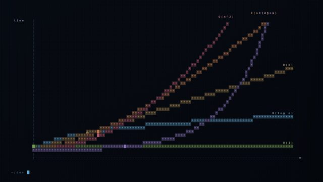</a><br><b>Big O</b><br><sub>six growth curves</sub></td>
<td align="center"><a href="assets/previews/diff.svg">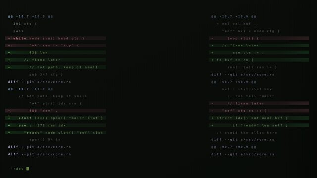</a><br><b>Diff</b><br><sub>hunks, adds and removes</sub></td>
<td align="center"><a href="assets/previews/tests.svg">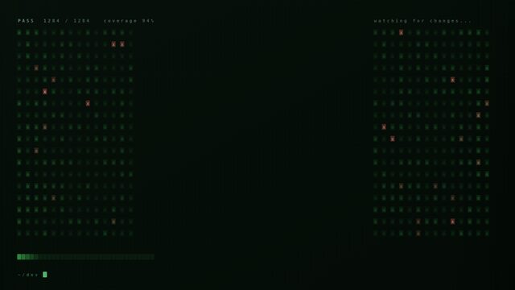</a><br><b>Green CI</b><br><sub>a test matrix going green</sub></td>
<td align="center"><a href="assets/previews/voidCursor.svg">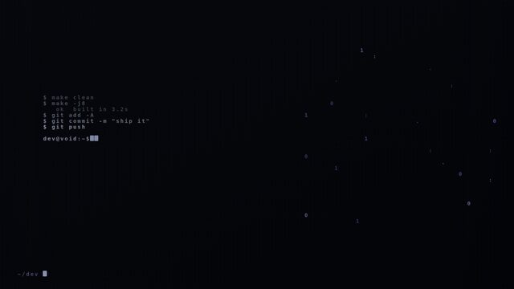</a><br><b>The Void</b><br><sub>a prompt and a cursor</sub></td>
</tr>
<tr>
<td align="center"><a href="assets/previews/compiler.svg">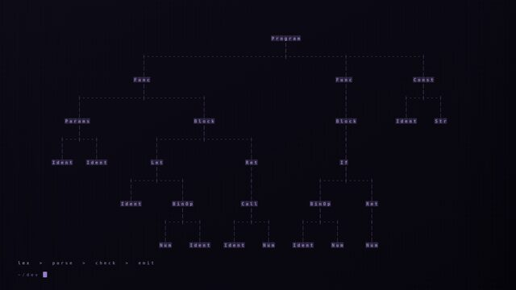</a><br><b>Compiler</b><br><sub>a syntax tree being walked</sub></td>
<td align="center"><a href="assets/previews/panic.svg"></a><br><b>Kernel Panic</b><br><sub>a stack trace in red</sub></td>
</tr>
</table>

### Creatures · 10

Things that live in the picture: koi, jellyfish, a whale, an owl, a cat on a sill.

<table>
<tr>
<td align="center"><a href="assets/previews/koi.svg">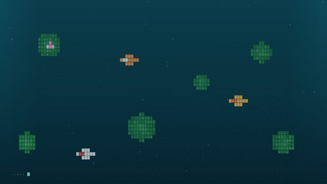</a><br><b>Lily Pond</b><br><sub>koi, lily pads, ripples</sub></td>
<td align="center"><a href="assets/previews/jellies.svg">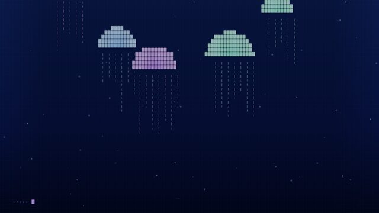</a><br><b>Moon Jellies</b><br><sub>drifting, pulsing jellyfish</sub></td>
<td align="center"><a href="assets/previews/whale.svg">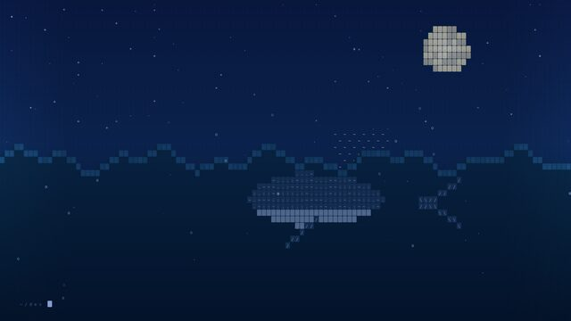</a><br><b>Whale Song</b><br><sub>a whale under the moon</sub></td>
<td align="center"><a href="assets/previews/butterflies.svg">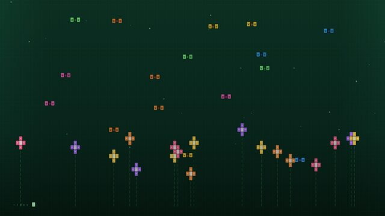</a><br><b>Butterfly House</b><br><sub>butterflies over flowers</sub></td>
</tr>
<tr>
<td align="center"><a href="assets/previews/cat.svg">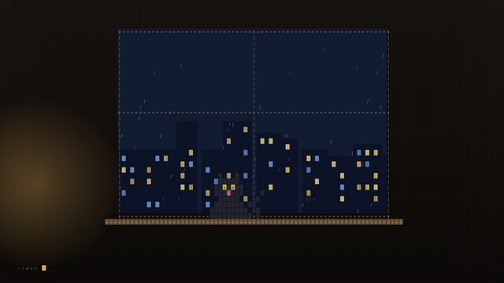</a><br><b>Window Cat</b><br><sub>rain, a skyline, a cat</sub></td>
<td align="center"><a href="assets/previews/birds.svg">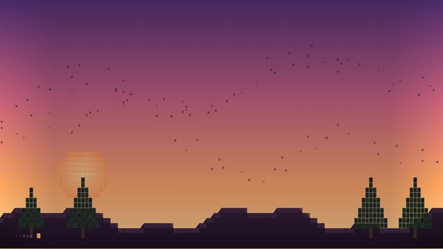</a><br><b>Murmuration</b><br><sub>starlings at dusk</sub></td>
<td align="center"><a href="assets/previews/fireflies.svg"></a><br><b>Firefly Field</b><br><sub>blinking over tall grass</sub></td>
<td align="center"><a href="assets/previews/owl.svg"></a><br><b>Night Owl</b><br><sub>a blinking owl on a branch</sub></td>
</tr>
<tr>
<td align="center"><a href="assets/previews/turtle.svg"></a><br><b>Sea Turtle</b><br><sub>a turtle over the reef</sub></td>
<td align="center"><a href="assets/previews/fox.svg"></a><br><b>Fox in Snow</b><br><sub>a fox trots through snow</sub></td>
</tr>
</table>

### Art · 6

Graphic styles: halftone, dither, riso, flow fields, sine waves and a radar sweep.

<table>
<tr>
<td align="center"><a href="assets/previews/halftone.svg"></a><br><b>Halftone</b><br><sub>a sun made of dots</sub></td>
<td align="center"><a href="assets/previews/dither.svg"></a><br><b>Dither Waves</b><br><sub>a gradient turned to noise</sub></td>
<td align="center"><a href="assets/previews/riso.svg"></a><br><b>Riso Hills</b> ☀<br><sub>two inks, slightly off register</sub></td>
<td align="center"><a href="assets/previews/flow.svg"></a><br><b>Flow Field</b><br><sub>sparks riding streamlines</sub></td>
</tr>
<tr>
<td align="center"><a href="assets/previews/sineStack.svg"></a><br><b>Sine Stack</b><br><sub>seven waves sliding past</sub></td>
<td align="center"><a href="assets/previews/radar.svg"></a><br><b>Radar</b><br><sub>a sweep and flaring blips</sub></td>
</tr>
</table>

### Minimal · 4

Almost nothing behind the chat, for people who want the room and a little life.

<table>
<tr>
<td align="center"><a href="assets/previews/horizon.svg"></a><br><b>Horizon</b><br><sub>one line and a small sun</sub></td>
<td align="center"><a href="assets/previews/dotgrid.svg"></a><br><b>Dot Grid</b><br><sub>dots breathing outward</sub></td>
<td align="center"><a href="assets/previews/grain.svg"></a><br><b>Static</b><br><sub>quiet film grain</sub></td>
<td align="center"><a href="assets/previews/lines.svg"></a><br><b>Slow Lines</b><br><sub>five lines, drifting</sub></td>
</tr>
</table>
<!-- gallery:end -->

## Install

You need **Claude Code 2.1.325 or later** (`claude --version`, `claude update`). The wallpapers draw in the **Code tab of Claude Desktop**; a plain terminal keeps its own look.

At the prompt of a Claude Code terminal session:

```text
/plugin install ascii-wallpaper-collection --marketplace deaneeth/claude-code-ascii-wallpapers
```

Answer `y` to add the marketplace, pick a scope (user scope puts it in every session), and enter your handle when asked.

From a shell:

```bash
claude plugin install ascii-wallpaper-collection --marketplace deaneeth/claude-code-ascii-wallpapers
```

In the Claude Desktop app, where `/plugin` does not run: click **+** next to the prompt box, then **Plugins**, **Add marketplace** with `deaneeth/claude-code-ascii-wallpapers`, then **Add plugin**.

Then start a new session in the Code tab.

## Use

Type `/wallpaper` for the picker above the prompt: a strip of live-scene thumbnails, a row of modes, six scenes a page. Click, or press the keys shown on the buttons.

| Do this | To get |
| --- | --- |
| `/wallpaper` | The picker. `1` to `6` pick a scene, `f` `c` `n` `s` `e` `d` `a` `r` `m` pick a mode, `p` / `b` page, `l` light scenes only, `x` surprise me, `0` off. |
| `/wallpaper aurora` | A scene by name (`/wallpaper list` shows every key). |
| `/wallpaper work` | A random **Focus** scene. Also `chill`, `nature`, `space`, `enjoy` (Energy), `dev`, `creatures`, `art`, `minimal`. |
| `/wallpaper light` / `dark` | A random light or dark scene from all of them. |
| `/wallpaper next` / `random` | The next scene in this mode / a surprise from everything. |
| `/wallpaper off` | No wallpaper, the app's own look. |

Your pick is remembered for the next session. The first run starts on **Silicon**.

## Make it yours

| Command | What it does |
| --- | --- |
| `/wallpaper accent #ff8f5e` | Your own accent color for buttons and highlights (`accent reset` to undo). |
| `/wallpaper glass blur 28` · `glass opacity 0.7` | How frosted the panels are (`glass reset`). |
| `/wallpaper color 220` · `color 340 light` | A colors-only theme with no picture: hue 0 to 359, dark or light. |
| `/wallpaper auto daynight` | Light scenes by day, dark by night, inside the mode you are in. |
| `/wallpaper auto shuffle 20` | A fresh scene from your mode every 20 minutes (on your next prompt). |
| `/wallpaper project` | Pin the current scene to this folder (`project off` to undo). |
| `/wallpaper reactive on` | Scenes react to what you do, see below. |
| `/wallpaper status` | What is on, and your settings. |

### Reactive scenes (opt in)

With `/wallpaper reactive on`, a command that finishes can change the scene for about 14 seconds, then your scene comes back:

| You | You get |
| --- | --- |
| `gh pr merge` or `git merge` succeeds | **Fireworks** |
| `git push` succeeds | **Rocket Launch** |
| a test run passes (`npm test`, `pytest`, `cargo test`, `go test`, ...) | **Green CI** |
| a test run fails | **Kernel Panic** |

It only looks at the command line and the last few lines of its output, and keeps nothing. There is a 25 second cooldown so it never flickers.

### Make your own scene

The plugin ships a skill. Ask Claude: **"make me a wallpaper of a lighthouse in a storm"** and it builds a new scene as its own small mod, with the same engine the built-in scenes use, never touching your installed set. See [`skills/make-wallpaper`](skills/make-wallpaper/SKILL.md).

### Your handle

The scenes sign **your handle** in a corner (`~/yourhandle` with a blinking cursor), in the Blueprint title block, in the Night Shift and Terminal prompts, and on the Graph Paper sheet. Set it when you install, or change it later in Claude Code's `/config` menu under this plugin's **Your handle** row. Letters, digits, `.`, `_` and `-` only, up to 16.

Prefer settings files? Add this to `~/.claude/settings.json`:

```json
{
  "pluginConfigs": {
    "ascii-wallpaper-collection": { "options": { "name": "yourhandle" } }
  }
}
```

## How it works

- **Scenes are plain SVG.** Each wallpaper is one SVG made of tiles (a colored plate and one glyph) placed on a 16 by 22 grid, with painted gradients for skies and water. Tiles are defined once and reused, which keeps every scene under the 131,072-character limit for a backdrop.
- **Motion is CSS.** Tiles shimmer in three phases, and things step cell to cell with stepped keyframes so movement snaps to the grid like a terminal. It all runs in a script-less sandboxed SVG frame: no JavaScript, no network.
- **The theme matches the scene.** `$.theme.set` paints about a hundred color tokens per scene from one hue and one accent, in dark or light, with code highlighting. Panels become frosted glass (blur 18, 50% tint) over the wallpaper.
- **Reduced motion is respected.** With "reduce motion" on in your system, the scenes hold still.
- **Text stays readable.** Each theme is run through Claude Code's color checker with high-contrast text on every surface, and none trips its "won't paint" failure. Permission prompts always keep the app's own look.

## FAQ

**Which Claude apps does it work in?** The Code tab of Claude Desktop. The terminal and editor extensions keep their own look.

**Nothing changes after I install it.** Start a new session after installing, and make sure Claude Code is 2.1.325 or later. If you run another plugin that sets a theme, turn it off: only one theme can be active at a time.

**Which scenes are light?** Open the picker and press `l`, or run `/wallpaper light`. They are marked ☀ in the gallery above.

**Can I use my own colors with a scene?** Yes: `/wallpaper accent #hex` recolors buttons and highlights, `/wallpaper glass ...` changes the frost, and `/wallpaper color <hue>` gives a colors-only theme.

**How do I remove it?** `claude plugin uninstall ascii-wallpaper-collection`.

**Does it slow Claude down?** The scenes are small static documents animated by the renderer, not scripts. The heaviest are around 110 KB of SVG. If your machine struggles, pick a quieter scene (the Minimal mode is built for that) or `/wallpaper off`. `scripts/perf.mjs` measures every scene.

## Contributing

New scenes are welcome. Each one is a function built from a small set of drawing helpers in [`hooks/engine.js`](hooks/engine.js). See [CONTRIBUTING.md](CONTRIBUTING.md) for how to add one, preview it, and register it in the picker.

## License

[MIT](LICENSE) © deaneeth. Not affiliated with or endorsed by Anthropic; "Claude" is a trademark of its owner.
